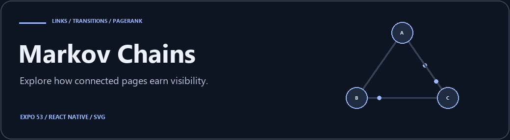

<div align="center">



# Markov Chains

**Explore how connected pages earn visibility.**


[Overview](#overview) &nbsp; · &nbsp; [Run locally](#run-locally) &nbsp; · &nbsp; [Explore the repository](https://github.com/mcampo0215/MarkovChains)

</div>

---

## Overview

An Expo / React Native interface for a three-page PageRank example. Navigate between pages A, B, and C, then inspect a node graph and the ranks returned by a separate API.

| Navigate | Inspect | Rank |
| :--- | :--- | :--- |
| Follow the example links between pages A, B, and C. | View the three-node relationship graph drawn with SVG. | Display API-provided scores and rank positions. |

## Run locally

Install Node.js and npm, then:

```sh
npm ci
npx expo start
```

Use the toolchain appropriate for the native target. This project uses Expo SDK 53, React Native 0.79, and Expo Router 5 as declared in `package.json`.

## Data dependency

`app/Data.jsx` and `app/customPageRank.jsx` fetch `http://localhost:8080/api/pageRank`. The expected response is an array with `page` and numeric `rank` fields, for example:

```json
[
  { "page": "A", "rank": 0.4 },
  { "page": "B", "rank": 0.3 },
  { "page": "C", "rank": 0.3 }
]
```

These numbers illustrate the response shape, not calculated project results. A PageRank backend is not included. Configure a reachable API address when running on an emulator or phone; its `localhost` is not generally your computer.

## Explore the code

| Source | Responsibility |
| :--- | :--- |
| [app/Links.jsx](app/Links.jsx) | Example outgoing links: A to B/C, B to C/A, C to A. |
| [app/FirstPage.jsx](app/FirstPage.jsx) | Page A and navigation into the rank view. |
| [app/Data.jsx](app/Data.jsx) | API-driven rank table. |
| [app/customPageRank.jsx](app/customPageRank.jsx) | SVG graph and scores sorted into visibility positions. |

## Current scope

The graph layout is fixed and rank computation is delegated to the external API. Some navigation paths use inconsistent casing, and `secondPage.jsx` references an undeclared router; these need attention before treating every route as complete. The banner illustrates graph traversal rather than live API output.

---

<p align="center"><a href="#markov-chains">Back to the top</a></p>
